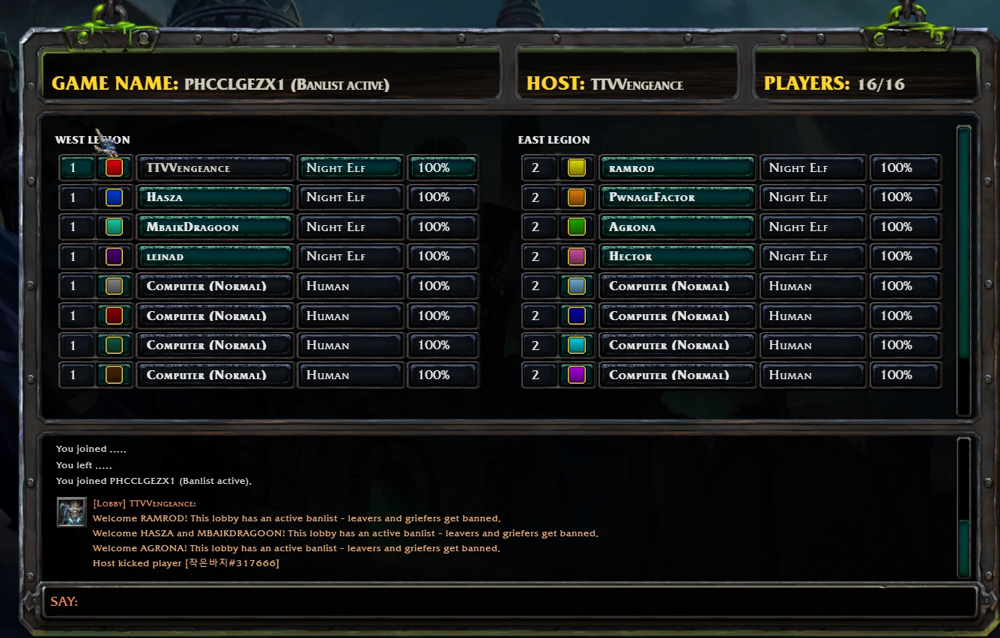
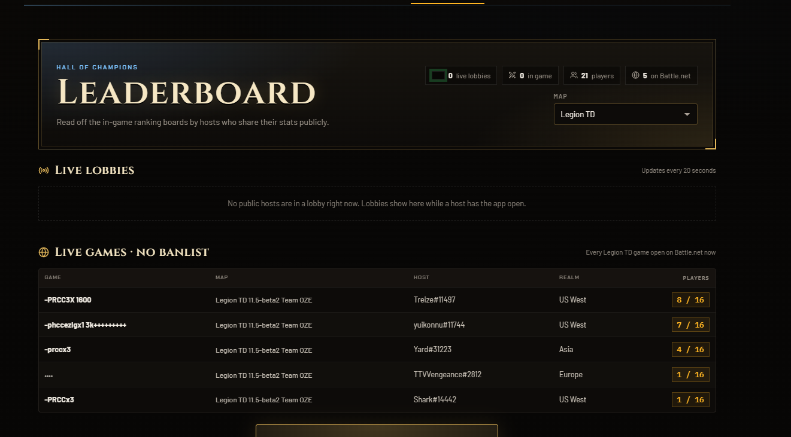
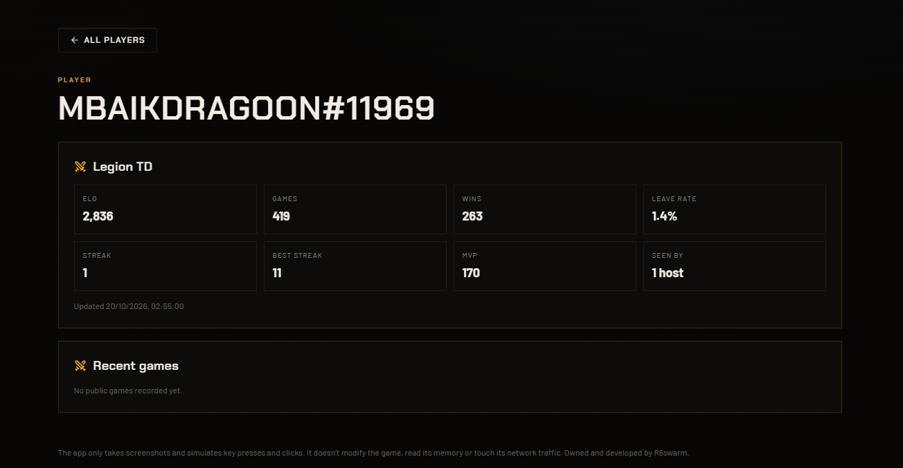

# 🛡️ Banlist / Auto Balancer

### A free lobby guard for **Warcraft III: Reforged** hosts

Spots banned players and alts as they join · balances teams by ELO · welcomes players with their stats · runs tournaments — all from your screen, while you host.

**[⬇️ Download &amp; full guide →](https://swarm-crcon.com/warcraft3)**  ·  **[💬 Support on Discord →](https://discord.gg/mUbpAsuq73)**

---

## What it is

**Banlist / Auto Balancer** is a host-side assistant for Warcraft III: Reforged custom games (built around **Legion TD**, with more maps coming). You run it on your own PC while you host. It watches your lobby, warns you when a banned player or a likely alt joins, greets players with their ELO and win/loss, balances teams fairly, and keeps a shared banlist so griefers banned by one host are caught by everyone.

It's **free**. You just need a free [Swarm CRCON](https://swarm-crcon.com/warcraft3) account to download it and get your key.

---

## 📸 Screenshots

**The app in action — welcoming players and guarding the lobby as they join:**

**The website — a live leaderboard and live lobbies at [swarm-crcon.com/warcraft3](https://swarm-crcon.com/warcraft3):**

**Per-player stats from the shared database — ELO, games, win rate, leave rate and more:**

---

## 🔒 Is it safe? Is it legit?

Short version: **yes.** It is a lobby-management tool, not a cheat, and it's deliberately built to be verifiable.

- **It only takes screenshots of your screen and simulates key presses and clicks** — the same things you do as a host. That's the entire mechanism.
- **It does not** read or write the game's memory, inject code or DLLs, modify game files, or touch Warcraft III's network traffic. There is nothing to detect in-game because it never goes near the game process.
- **It gives no in-game advantage.** It helps you *run your lobby* (bans, balance, welcomes) — it does not help you *win matches*.
- **You stay in control.** Every action — a welcome, a kick, a team swap — is just text typed into chat or a click, which you can see happen and turn off in Settings.
- **Verify every download yourself.** The [download page](https://swarm-crcon.com/warcraft3) publishes the exact **SHA‑256** of each release. Drop the file (or its hash) into [VirusTotal](https://www.virustotal.com/) and confirm it matches before you run it.
- **Your data stays yours.** Nothing leaves your PC unless you turn on the optional Stats API, and even then it's only game/stat data going to Swarm CRCON — never your Warcraft III account or credentials.
- **A secure API.** Sign-in and activation happen through your browser on swarm-crcon.com — the app never asks for your password. Your key is encrypted at rest, **locked to one machine**, revocable at any time, and the app only ever talks to the API over **HTTPS**.

The app is distributed as a **compiled Windows build** (closed-source), but its behaviour is transparent and every download is hash-verifiable.

---

## ✨ Features

- **Ban &amp; alt detection** — banned players are flagged the instant they join, with optional **auto-kick**. Likely alts are caught by look-alike and similar names (I/l/1, O/0, different `#tag`, fuzzy matches), not just exact ones.
- **Team balancing** — balances by ELO with the fewest swaps and shows each team's **forecast win chance** before you start.
- **Shared ELO database** — ELO, games, win rate and leave rate are tracked in a **shared database across every host** running the app, so balancing and welcomes use real ratings instead of guesses. Your own in-game ranking-board reads feed back into it, so the database keeps improving the more it's used.
- **Personal welcomes** — greets players as they join, including their **ELO and W‑L** if they're known, matched by name even without the `#number`.
- **Leaver protection** — flags known leavers before the game and detects mid-game leaves, with optional ban prompts.
- **Shared banlists** — share bans between hosts via a shared Dropbox/OneDrive/Google Drive file (read &amp; write) or a read-only web link (a league's published list).
- **Tournaments** — build teams, heats and knockout brackets in the app; it auto-sorts players onto their teams, kicks anyone not rostered, asks who won, and posts the standings and bracket to the website.
- **Live leaderboard &amp; lobbies** — a public Legion TD leaderboard and a live view of open lobbies at [swarm-crcon.com/warcraft3](https://swarm-crcon.com/warcraft3).
- **Discord integration** — alerts, a live lobby message that updates as players join, and end-of-game recaps.
- **Self-updating** — checks for new versions on launch and updates itself.

---

## ⚙️ How it works

1. **Reads your lobby off the screen.** Using Windows screen capture + OCR, it mirrors your lobby — player names, colours, slots, the map, and the chat — without reading any game data.
2. **Acts only when you're the host**, and only in chat: it types welcomes, ban warnings and `!swap` / `!kick` commands, exactly as you would.
3. **Looks players up** against the shared known-players database and the in-game Player Ranking board to show ELO, games, win rate and leave rate.
4. **Keeps your history** locally (bans, players seen, map stats, games) and — only if you opt in — syncs anonymised game/stat data to Swarm CRCON so stats, live lobbies and tournaments work across hosts.

---

## 🎮 In-game chat commands

Players can ask the app for info in lobby or in-game chat (answers go to All chat):

| Command | What it does |
|---|---|
| `?stats [name]` / `?me` | A player's ELO, games, win rate and leave rate |
| `?teams` / `?odds` | The current teams and forecast win chance |
| `?top` | Top players on the map |
| `?leavers` | Who in the lobby has a high leave rate |
| `?vs name` | Your record against that player |
| `?time` | How long the lobby/game has been going |
| `?rules` · `?discord` · `?version` · `?help` | Lobby info, links and the command list |

Hosts also get private commands (`?ban name [reason]`, `?unban name`, `?note name text`) so you never have to alt-tab mid-game. Every command can be toggled on/off in the app's Commands tab, and you can add your own.

---

## 🗺️ Roadmap

Built for **Legion TD** first — **more maps and per-map leaderboards are on the way**, so the same lobby guard, shared stats and team balancing will cover more of Warcraft III's custom games. Tournaments, the live leaderboard and the shared database are already live and grow with every host who joins.

---

## 📥 Get it

**[swarm-crcon.com/warcraft3](https://swarm-crcon.com/warcraft3)** — create a free account, download `WC3Banlist.exe` (one file, nothing to install), unzip and run. The site also has the full **Guide**, the live leaderboard, tournaments and your banlist link.

Requirements: **Windows 10/11**, Warcraft III: Reforged.

---

## 🆘 Support

Questions, bug reports or feature ideas? **[Join the Discord →](https://discord.gg/mUbpAsuq73)** — it's the fastest way to reach us.

---

Owned and developed by **R6swarm** (Discord) / **TTVVengeance#2812** (Battle.net).

*Not affiliated with, endorsed by, or associated with Blizzard Entertainment. Warcraft III is a trademark of Blizzard Entertainment.*

